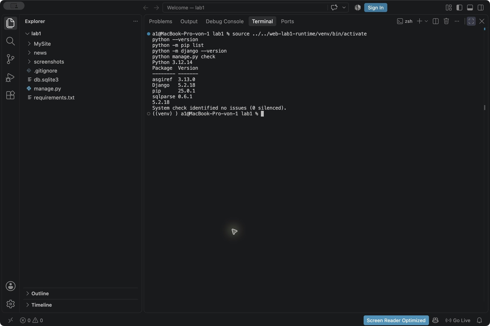
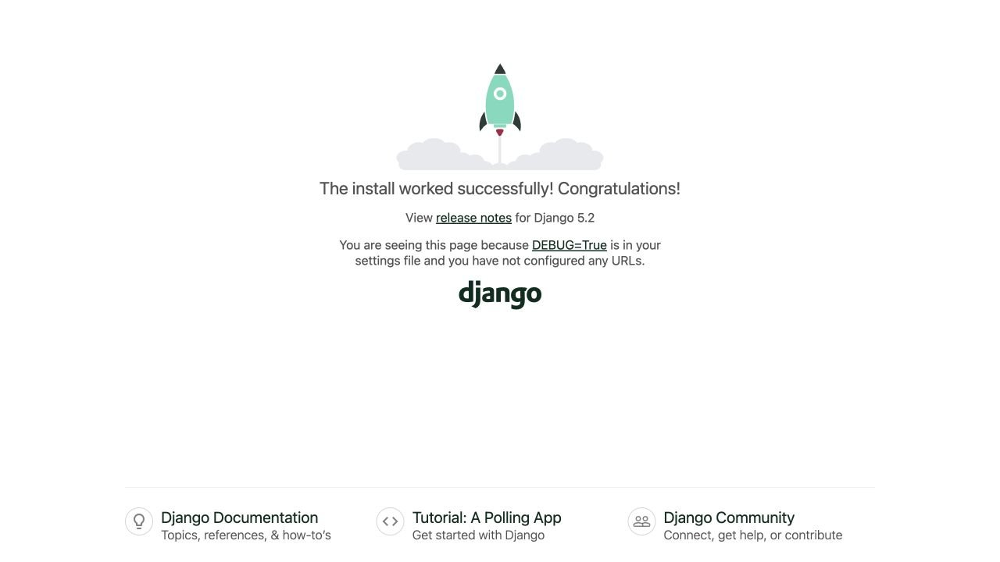
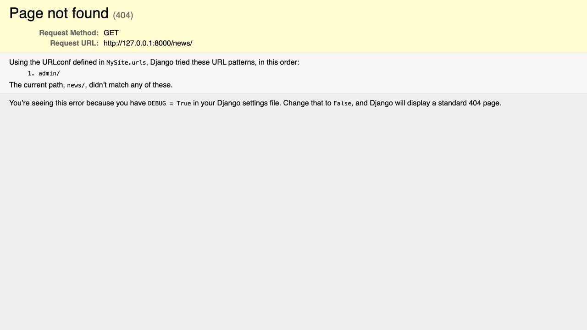
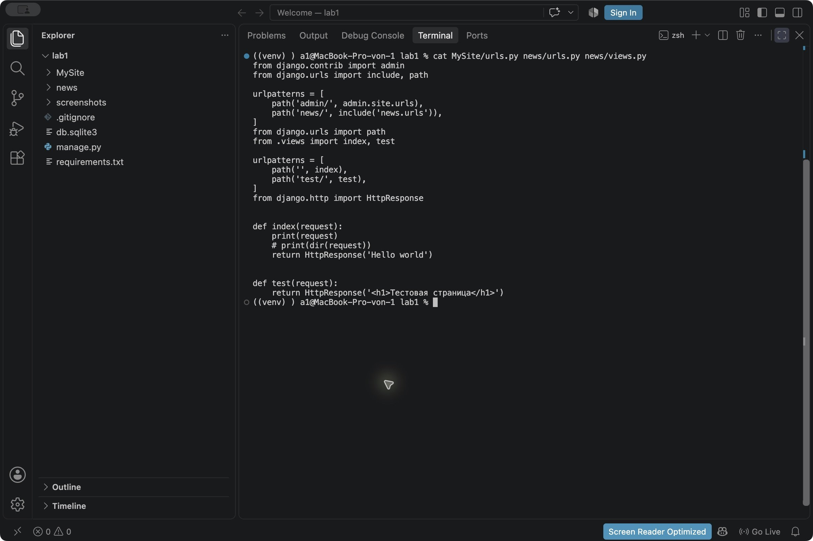
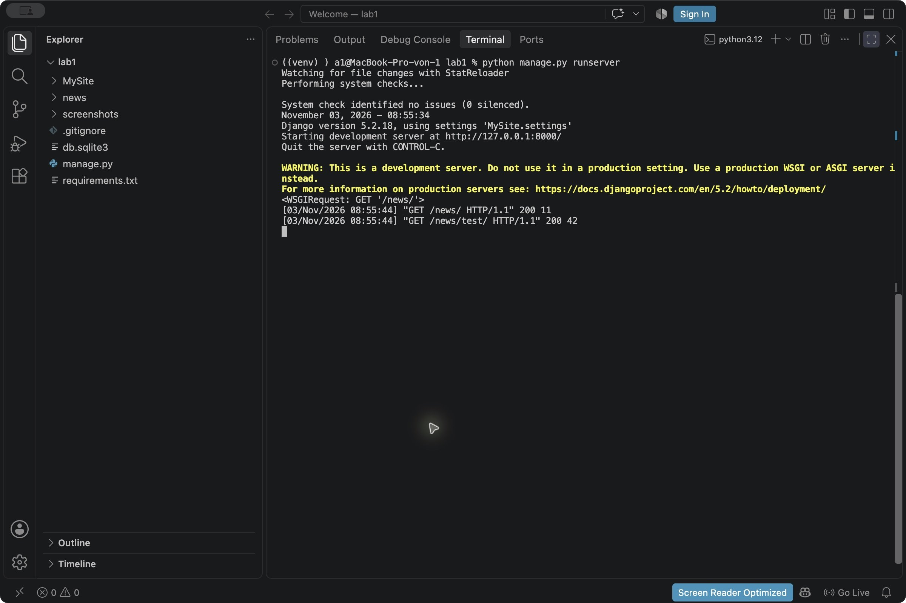

# Лабораторная работа № 1

## Создание виртуального окружения. Контроллеры и маршруты

**Студент:** Осипов Герман Юрьевич  
**Группа:** ПИЖ-б-о-25-2  
**Дисциплина:** Разработка web-приложений  
**Технологии:** Python, Django, venv, VS Code  
**Год:** 2026

## Содержание

- [Цель работы](#цель-работы)
- [Теоретическое обоснование](#теоретическое-обоснование)
- [Постановка задачи](#постановка-задачи)
- [Выполнение работы](#выполнение-работы)
- [Проверка приложения](#проверка-приложения)
- [Запуск проекта из репозитория](#запуск-проекта-из-репозитория)
- [Вывод](#вывод)
- [Ссылка на репозиторий](#ссылка-на-репозиторий)

## Цель работы

Настроить виртуальное окружение Python, установить Django и создать веб-приложение. Разработать обработчики HTTP-запросов и настроить маршруты проекта и приложения.

## Теоретическое обоснование

Виртуальное окружение содержит отдельный интерпретатор и набор библиотек для проекта. Оно создается модулем `venv`. После активации команды `python` и `pip` используют это окружение, а не глобальные пакеты.

Django - веб-фреймворк Python. Проект содержит общие настройки и маршруты, а приложение отвечает за отдельную часть сайта. В работе проект называется `MySite`, приложение - `news`.

Представление, или view, принимает объект `request` и возвращает HTTP-ответ. В этой работе представления написаны как функции. Для формирования простого ответа используется `HttpResponse`.

Маршруты описываются в списке `urlpatterns`. Функция `path()` связывает путь с обработчиком. Функция `include()` подключает маршруты отдельного приложения, чтобы основной файл проекта не содержал все адреса сайта.

Команда `python manage.py runserver` запускает встроенный сервер разработки. По умолчанию он доступен на `127.0.0.1:8000`. Сервер выводит запросы в терминал и перезапускается после изменения существующих файлов. Для остановки используется Ctrl+C.

## Постановка задачи

В методических указаниях отдельный индивидуальный вариант не предусмотрен. Нужно выполнить практический пример:

1. Создать и активировать виртуальное окружение, посмотреть установленные пакеты.
2. Установить Django и создать проект `MySite`.
3. Запустить сервер и проверить стартовую страницу.
4. Создать приложение `news` и зарегистрировать его в настройках.
5. Написать функции `index` и `test`, возвращающие текст и HTML.
6. Настроить прямые маршруты, затем вынести адреса приложения в `news/urls.py` и подключить их через `include()`.
7. Проверить итоговые страницы `/news/` и `/news/test/`.

## Выполнение работы

### 1. Виртуальное окружение и установка Django

Работа выполнена в macOS. Использованы Python 3.12.14 и Django 5.2.18. Для проекта создано отдельное виртуальное окружение через `venv`.

Для повторения в папке работы можно создать окружение командой:

```bash
python -m venv .venv
```

Активация в macOS и Linux:

```bash
source .venv/bin/activate
```

В Windows PowerShell:

```powershell
.\.venv\Scripts\Activate.ps1
```

После активации проверяются пакеты и устанавливается Django:

```bash
python -m pip list
python -m pip install Django==5.2.18
python -m django --version
```

На скриншоте показано рабочее окружение после установки. Версия Django - `5.2.18`, также установлены его зависимости `asgiref` и `sqlparse`.



*Рисунок 1 - Версии Python и Django, список пакетов и проверка проекта.*

Виртуальное окружение и кеш Python в репозиторий не включены. В `requirements.txt` указана версия Django для повторной установки.

### 2. Создание проекта и первый запуск

Проект создается командой:

```bash
python -m django startproject MySite .
```

Точка в конце означает текущую папку. Поэтому `manage.py` и пакет конфигурации `MySite` находятся непосредственно в каталоге `lab1`.

Назначение основных файлов:

- `manage.py` - команды управления проектом.
- `MySite/settings.py` - настройки и список приложений.
- `MySite/urls.py` - основные маршруты сайта.
- `MySite/asgi.py` и `MySite/wsgi.py` - точки входа для серверов соответствующих типов.

Для служебных таблиц Django выполнены миграции, затем запущен сервер:

```bash
python manage.py migrate
python manage.py runserver
```

До настройки собственных маршрутов по адресу `http://127.0.0.1:8000/` открылась стандартная стартовая страница Django.



*Рисунок 2 - Первый запуск проекта до подключения маршрутов приложения.*

База `db.sqlite3` создается локально. В этой работе собственных моделей и пользовательских записей нет; файл базы в репозиторий не включен и создается командой `migrate`.

### 3. Создание и регистрация приложения

В папке с `manage.py` приложение создается командой:

```bash
python manage.py startapp news
```

В `MySite/settings.py` приложение подключено в `INSTALLED_APPS`:

```python
INSTALLED_APPS = [
    'django.contrib.admin',
    'django.contrib.auth',
    'django.contrib.contenttypes',
    'django.contrib.sessions',
    'django.contrib.messages',
    'django.contrib.staticfiles',
    'news.apps.NewsConfig',
]
```

Класс `NewsConfig` находится в `news/apps.py`. Файлы `models.py` и `admin.py` пока содержат стандартные заготовки, потому что работа посвящена представлениям и маршрутам.

### 4. Представления index и test

В `news/views.py` реализованы два обработчика:

```python
from django.http import HttpResponse


def index(request):
    print(request)
    # print(dir(request))
    return HttpResponse('Hello world')


def test(request):
    return HttpResponse('<h1>Тестовая страница</h1>')
```

`index()` возвращает строку `Hello world`. Вызов `print(request)` выводит полученный запрос в терминал. Для изучения атрибутов запроса временно использовался `print(dir(request))`, после чего эта строка закомментирована.

`test()` возвращает HTML-разметку. Браузер отображает строку внутри `<h1>` как заголовок страницы. Название функции `test` взято из методички: это обычное представление страницы.

Если представление написано, но его путь еще не зарегистрирован, адрес не открывается. На промежуточном этапе запрос `/news/` вернул 404, поскольку в маршрутах оставалась только админка.



*Рисунок 3 - Django не находит `/news/` до добавления маршрута.*

### 5. Прямые маршруты

На первом этапе представления подключались непосредственно в `MySite/urls.py`:

```python
from django.contrib import admin
from django.urls import path
from news.views import index, test

urlpatterns = [
    path('admin/', admin.site.urls),
    path('news/', index),
    path('test/', test),
]
```

После этого `/news/` вернул `Hello world`, а `/test/` показал заголовок.


*Рисунок 4 - Промежуточная проверка страницы `/test/`.*

### 6. Разделение маршрутов через include

По методичке страница `test` должна находиться внутри приложения `news`. Поэтому в итоговой конфигурации маршруты разделены на два файла.

`MySite/urls.py`:

```python
from django.contrib import admin
from django.urls import include, path

urlpatterns = [
    path('admin/', admin.site.urls),
    path('news/', include('news.urls')),
]
```

`news/urls.py`:

```python
from django.urls import path
from .views import index, test

urlpatterns = [
    path('', index),
    path('test/', test),
]
```

Сначала Django находит префикс `news/` в маршрутах проекта. Оставшуюся часть адреса он передает маршрутам приложения. Пустой путь вызывает `index`, а `test/` вызывает `test`.



*Рисунок 5 - Содержимое `MySite/urls.py`, `news/urls.py` и `news/views.py` в терминале VS Code.*

Итоговый путь запроса: браузер -> `MySite/urls.py` -> `news/urls.py` -> функция из `news/views.py` -> `HttpResponse` -> браузер.

## Проверка приложения

После разделения маршрутов выполнены запросы к работающему серверу:

| Адрес | HTTP-код | Результат |
|---|---|---|
| `/news/` | 200 | `Hello world` |
| `/news/test/` | 200 | `<h1>Тестовая страница</h1>` |
| `/test/` | 404 | Старый прямой маршрут больше не зарегистрирован |
| `/not-found/` | 404 | Неизвестный адрес |


*Рисунок 6 - Итоговый адрес `http://127.0.0.1:8000/news/`.*


*Рисунок 7 - Итоговый адрес `http://127.0.0.1:8000/news/test/`.*

В журнале сервера видны GET-запросы и коды `200`. При изменении `views.py` сервер сообщил о перезапуске и снова стал обрабатывать запросы. Команда `python manage.py check` завершилась сообщением `System check identified no issues (0 silenced)`.



*Рисунок 8 - Запуск сервера и обработка двух итоговых страниц.*

Стартовая страница `/` на рисунке 2 относится к первоначальному этапу. После добавления собственных маршрутов путь `/` не зарегистрирован и не является страницей приложения.

## Запуск проекта из репозитория

Перейти в папку `lab1`, создать и активировать окружение, как показано выше. Установить зависимости и запустить проект:

```bash
python -m pip install -r requirements.txt
python manage.py migrate
python manage.py runserver
```

Открыть:

- http://127.0.0.1:8000/news/
- http://127.0.0.1:8000/news/test/

Если порт 8000 занят другой лабораторной, сначала остановить ее сервер через Ctrl+C. Также можно выбрать другой порт: `python manage.py runserver 8001`.

Структура работы:

```text
lab1/
├── .gitignore
├── README.md
├── requirements.txt
├── manage.py
├── MySite/
│   ├── __init__.py
│   ├── settings.py
│   ├── urls.py
│   ├── asgi.py
│   └── wsgi.py
├── news/
│   ├── __init__.py
│   ├── apps.py
│   ├── admin.py
│   ├── models.py
│   ├── views.py
│   ├── urls.py
│   └── migrations/
│       └── __init__.py
└── screenshots/
```

Настройки рассчитаны на локальную учебную работу: `DEBUG=True`, локальные `ALLOWED_HOSTS` и учебный `SECRET_KEY`.

## Вывод

Создано виртуальное окружение и установлен Django. Подготовлен проект `MySite`, зарегистрировано приложение `news`, реализованы два обработчика HTTP-запросов. Прямые маршруты заменены подключением `news.urls` через `include()`.

Проверены текстовый ответ, HTML-заголовок и ошибка 404. Основная сложность состояла в различии адресов проекта и приложения: путь `test/` внутри `news.urls` образует адрес `/news/test/`, потому что префикс уже задан в `MySite/urls.py`.

## Ссылка на репозиторий

https://github.com/foidslayer33367/web/tree/main/lab1

Методические указания: «Лабораторная работа 1-2.pdf», лабораторная работа № 1 «Создание виртуального окружения. Контроллеры и маршруты».
