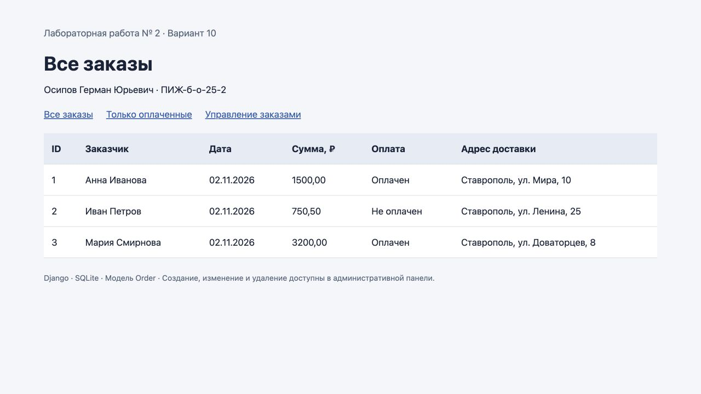
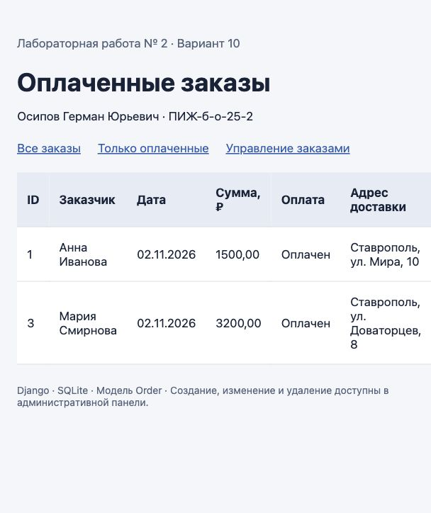
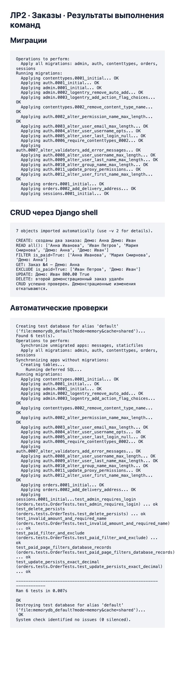

# Отчёт по лабораторной работе № 2

**Тема:** Модели. CRUD.  
**Вариант:** 10 — Заказы.  
**Дисциплина:** Разработка web-приложений.  
**Выполнил:** Осипов Герман Юрьевич, группа ПИЖ-б-о-25-2.  
**Проверил:** Новикова Е.Н.

## Цель работы

Разработать модель данных, научиться создавать и применять миграции, работать с базой данных и выполнять операции CRUD средствами Django ORM.

## Индивидуальное задание

Создать модель Order с полями customer_name, order_date, total_amount, is_paid. Добавить текстовое поле delivery_address и вывести все оплаченные заказы. Создать проект и приложение, выполнить миграции, наполнить базу через Django shell и проверить CRUD.

## Ход работы

### 1. Подготовка проекта

Созданы Django-проект config и приложение orders. Приложение зарегистрировано в INSTALLED_APPS, маршруты подключены через include(). SQLite хранится в project/db.sqlite3. Для воспроизведения установки приведены команды в README.md, версии зависимостей закреплены в project/requirements.txt.

```bash
python -m venv .venv
python -m pip install -r requirements.txt
```

### 2. Модель Order

| Поле | Тип | Назначение |
|---|---|---|
| id | BigAutoField | Автоматический первичный ключ |
| customer_name | CharField(max_length=150) | Обязательное имя заказчика |
| order_date | DateField | Дата заказа, по умолчанию локальная дата |
| total_amount | DecimalField(12, 2) | Сумма с двумя знаками после запятой |
| is_paid | BooleanField(default=False) | Признак оплаты |
| delivery_address | TextField(blank=True, default='') | Адрес доставки |

Для суммы добавлена проверка неотрицательного значения. Валидация вызывается формами Django и методом full_clean(); обычный save() сам по себе full_clean() не запускает.

```python
from decimal import Decimal
from django.core.validators import MinValueValidator
from django.db import models
from django.utils import timezone


class Order(models.Model):
    customer_name = models.CharField('Имя заказчика', max_length=150)
    order_date = models.DateField('Дата заказа', default=timezone.localdate)
    total_amount = models.DecimalField('Сумма заказа', max_digits=12, decimal_places=2,
                                      validators=[MinValueValidator(Decimal('0.00'))])
    is_paid = models.BooleanField('Оплачен', default=False)

    delivery_address = models.TextField('Адрес доставки', blank=True, default='')

    class Meta:
        ordering = ['id']
        verbose_name = 'Заказ'
        verbose_name_plural = 'Заказы'

    def __str__(self):
        return f'Заказ №{self.pk} — {self.customer_name}'
```

### 3. Создание и применение миграций

Сначала создана модель без адреса и выполнен makemigrations orders. Затем добавлен delivery_address и выполнен makemigrations orders --name add_delivery_address. Благодаря этому добавление поля представлено отдельным изменением схемы.

```bash
python manage.py makemigrations orders
python manage.py makemigrations orders --name add_delivery_address
python manage.py sqlmigrate orders 0001
python manage.py sqlmigrate orders 0002
python manage.py migrate
```

Результат применения миграций сохранён в migrations.txt. Основная таблица — orders_order. Начальный SQL хранится в schema.sql, SQL добавления адреса — в add_address.sql. SQLiteStudio может открыть приложенную БД напрямую; установка этого менеджера не требуется для запуска проекта.

### 4. Работа с ORM через shell

Выполнена команда python manage.py shell с перенаправлением файла demo_crud.py на стандартный ввод. Код ниже воспроизводит создание через конструктор и create(), чтение, фильтрацию, исключение, получение по ключу, обновление и удаление.

```python
"""Выполнить: python manage.py shell < demo_crud.py. Изменения примера откатываются."""
from datetime import date
from decimal import Decimal
from django.db import transaction
from orders.models import Order

with transaction.atomic():
    first = Order(customer_name='Демо: Анна', order_date=date(2026, 11, 2),
                  total_amount=Decimal('1500.00'), is_paid=True,
                  delivery_address='Ставрополь, ул. Мира, 1')
    first.full_clean()
    first.save()
    second = Order.objects.create(customer_name='Демо: Иван', total_amount=Decimal('750.50'),
                                  is_paid=False, delivery_address='Ставрополь, ул. Ленина, 2')
    print('CREATE: созданы два заказа:', first.customer_name, second.customer_name)
    print('READ all():', list(Order.objects.all().values_list('customer_name', flat=True)))
    print('FILTER is_paid=True:', list(Order.objects.filter(is_paid=True).values_list('customer_name', flat=True)))
    print('GET:', Order.objects.get(pk=first.pk))
    print('EXCLUDE is_paid=True:', list(Order.objects.exclude(is_paid=True).values_list('customer_name', flat=True)))
    second.is_paid = True
    second.total_amount = Decimal('800.00')
    second.save()
    second.refresh_from_db()
    assert second.is_paid and second.total_amount == Decimal('800.00')
    print('UPDATE:', second.customer_name, second.total_amount, second.is_paid)
    deleted_pk = second.pk
    second.delete()
    assert not Order.objects.filter(pk=deleted_pk).exists()
    print('DELETE: второй демонстрационный заказ удалён')
    print('CRUD успешно проверен. Демонстрационные изменения откатываются.')
    transaction.set_rollback(True)
```

Фактический вывод выполнения:

```text
7 objects imported automatically (use -v 2 for details).

CREATE: созданы два заказа: Демо: Анна Демо: Иван
READ all(): ['Анна Иванова', 'Иван Петров', 'Мария Смирнова', 'Демо: Анна', 'Демо: Иван']
FILTER is_paid=True: ['Анна Иванова', 'Мария Смирнова', 'Демо: Анна']
GET: Заказ №4 — Демо: Анна
EXCLUDE is_paid=True: ['Иван Петров', 'Демо: Иван']
UPDATE: Демо: Иван 800.00 True
DELETE: второй демонстрационный заказ удалён
CRUD успешно проверен. Демонстрационные изменения откатываются.
```

Операции примера выполняются внутри транзакции, которая в конце откатывается. Проверки сохранения и удаления проходят до отката. В приложенной базе остаются три демонстрационных заказа из фикстуры.

### 5. Индивидуальная выборка и интерфейс

```python
Order.objects.filter(is_paid=True)
```

В демонстрационной базе запрос возвращает заказы Анны Ивановой и Марии Смирновой. Неоплаченный заказ Ивана Петрова исключён.



Рисунок 1 — Работающий список всех заказов.



Рисунок 2 — Результат фильтрации оплаченных заказов.

Создание, изменение и удаление через веб-интерфейс доступны в административной панели после создания собственного суперпользователя. Учётные данные в архив не включены.

### 6. Проверка результатов

Выполнены check, makemigrations --check --dry-run и шесть тестов. Ошибок проверки Django нет, новых незаписанных изменений модели нет, все тесты прошли. Тесты запускаются на отдельной временной базе и не изменяют демонстрационные записи.



Рисунок 3 — Снимок страницы с фактическими сохранёнными результатами миграций, выполнения shell и тестов. Это представление вывода команд, а не снимок терминала.

Полный журнал тестов: tests.txt.

## Контрольные вопросы

### 1. Что такое модель в Django и для чего она используется?

Модель — класс, наследующий models.Model. Она описывает поля, ограничения и поведение данных, обычно соответствует таблице базы данных. В работе Order соответствует таблице orders_order.

### 2. Какие типы полей вы знаете? Приведите примеры.

CharField хранит короткий текст, TextField — длинный, IntegerField — целое число, DecimalField — точное десятичное значение, DateField — дату, DateTimeField — дату и время, BooleanField — логическое значение, ImageField — путь к изображению. Для суммы заказа выбран DecimalField, чтобы не использовать неточные вычисления float.

### 3. Чем отличаются blank=True и null=True?

blank=True разрешает пустое значение при валидации модели и форм; null=True разрешает SQL NULL в базе. Для необязательного текстового адреса используется blank=True и пустая строка по умолчанию. В методичке есть опечатка: blank=True не делает поле обязательным.

### 4. Что такое миграции и зачем они нужны? Опишите основные команды.

Миграции фиксируют изменения структуры данных. makemigrations создаёт файлы изменений, migrate применяет их к БД, sqlmigrate показывает SQL, showmigrations показывает состояние. В проекте первая миграция создаёт Order, вторая добавляет delivery_address.

### 5. Как создать суперпользователя для доступа к административной панели Django?

После migrate выполнить python manage.py createsuperuser, ввести имя, почту и пароль, затем войти на /admin/. Модель регистрируется в orders/admin.py. Создание учётной записи выполняется пользователем локально.

### 6. Что такое ORM? Перечислите основные методы для выполнения операций CRUD.

ORM связывает объекты Python с таблицами БД. Create: конструктор и save() либо objects.create(); Read: all(), filter(), get(), exclude(); Update: присвоение атрибутов и save(); Delete: delete().

### 7. В чём разница между filter() и get()?

filter() возвращает QuerySet с нулём, одной или несколькими записями. get() возвращает ровно один объект; при отсутствии вызывает DoesNotExist, при нескольких совпадениях — MultipleObjectsReturned. Для уникального ID удобно get(pk=...).

### 8. Как настроить загрузку изображений в проекте Django?

В общем случае нужны Pillow, ImageField(upload_to=...), MEDIA_ROOT и MEDIA_URL. В DEBUG корневой urls.py дополняют static(settings.MEDIA_URL, document_root=settings.MEDIA_ROOT). Для HTML-формы нужен enctype="multipart/form-data", а обработчик принимает request.FILES. В варианте Order изображений нет, поэтому эти настройки не добавлялись.

### 9. Для чего нужен метод __str__ в модели?

Он возвращает понятное строковое представление объекта для shell, админки и журналов. В Order это номер заказа и имя заказчика.

### 10. Что произойдёт, если выполнить makemigrations, но не выполнить migrate?

Файл миграции появится, но схема БД не изменится. Новые таблицы или столбцы останутся недоступны; обращения к ним могут закончиться ошибкой OperationalError. Требуется применить миграцию командой migrate.

## Вывод

Создан Django-проект для учёта заказов. Модель Order содержит все поля варианта 10, адрес доставки добавлен отдельной миграцией. Миграции применены к SQLite. Через Django shell проверены создание, чтение, обновление и удаление записей, методы get(), filter() и exclude(). Получена выборка всех оплаченных заказов. Работоспособность подтверждена шестью тестами и проверкой конфигурации Django.

## Источники

1. Методические указания «Лабораторная работа 2-2.pdf», вариант 10.
2. [Django 5.2 — Модели](https://docs.djangoproject.com/en/5.2/topics/db/models/).
3. [Django 5.2 — Миграции](https://docs.djangoproject.com/en/5.2/topics/migrations/).
4. [Django 5.2 — Запросы ORM](https://docs.djangoproject.com/en/5.2/topics/db/queries/).
5. [Репозиторий проекта](https://github.com/foidslayer33367/web).
